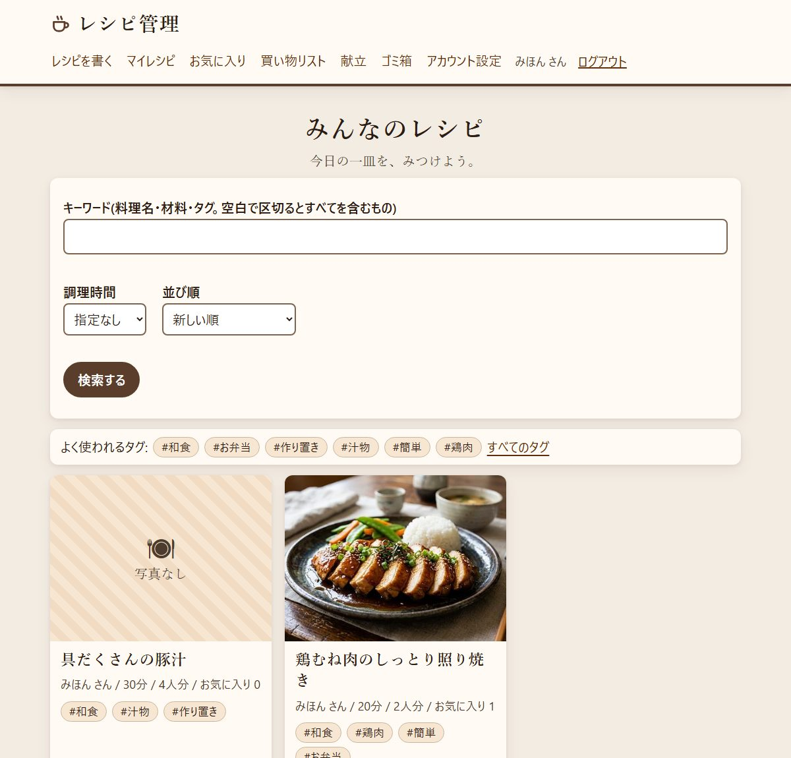
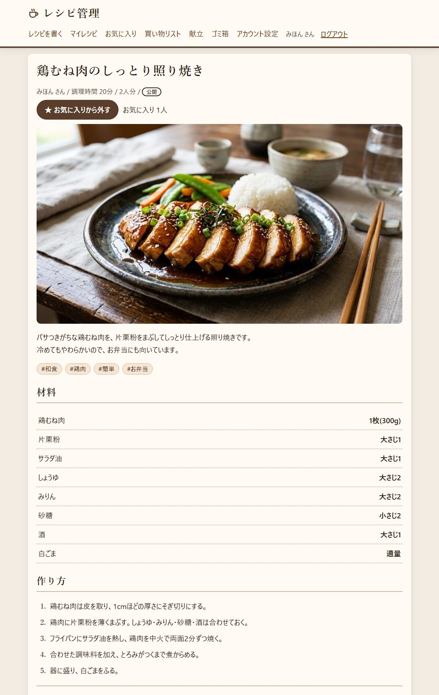
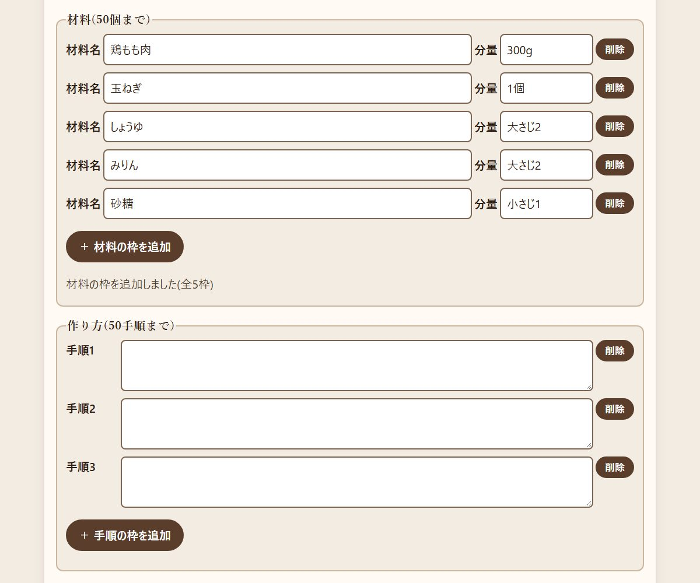
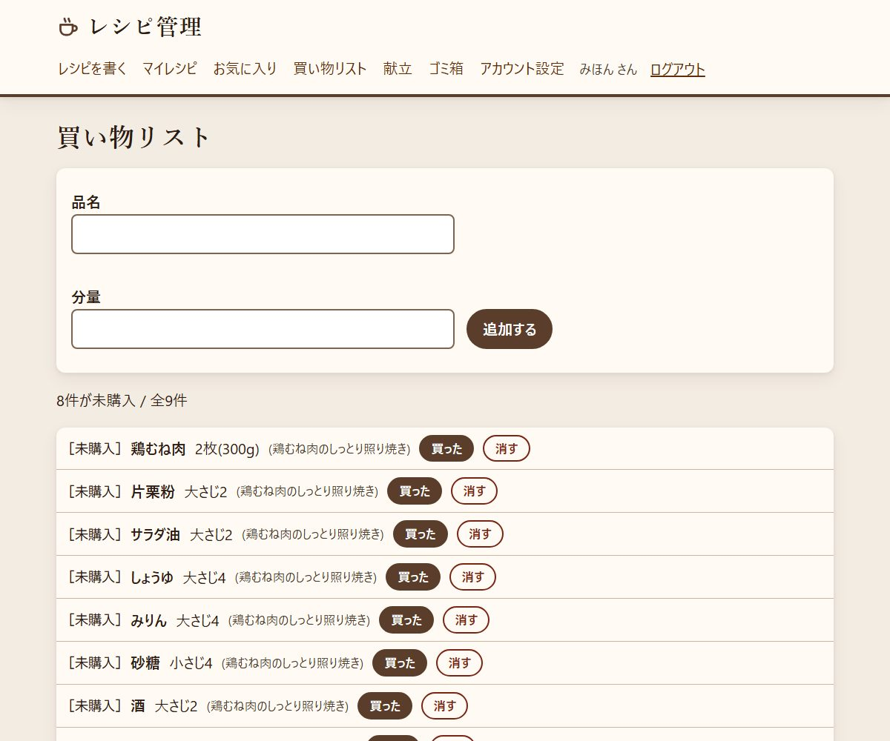
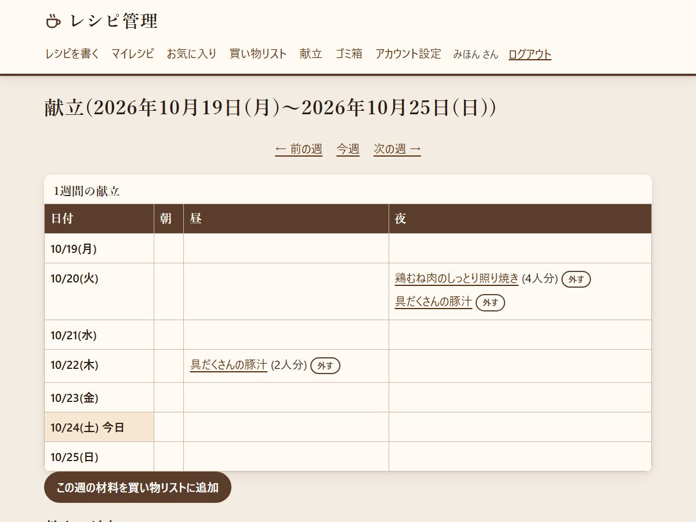
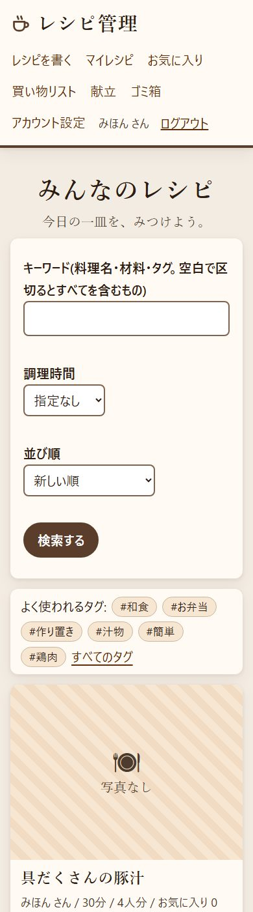

# レシピ管理

レシピを登録・検索・共有できる Web アプリです。会員になると、レシピの投稿のほか、お気に入り・買い物リスト・献立が使えます。
PC でもスマホでも使え、大きめの文字・高いコントラスト・キーボード操作など、見やすさに気を配っています。



## 主な機能

**レシピ**
- 料理名・説明・材料と分量・作り方・調理時間・人数・写真(1枚)・タグを登録・編集できる
- 材料と作り方の枠は、ボタンで増やしたり減らしたりできる(それぞれ 50 まで)
- 「公開」「非公開(自分だけ)」を選べる。削除したレシピはゴミ箱に入り、30日以内なら元に戻せる

**さがす**
- 料理名・材料・タグのキーワード検索(空白で区切ると、すべての語を含むもの)
- タグ・調理時間での絞り込み、新しい順・お気に入りが多い順・調理時間が短い順
- よく使われるタグの一覧

**使う**
- お気に入り
- 買い物リスト: レシピの材料をまとめて追加。人数を指定すると分量を計算し直す(「大さじ1と1/2」の2倍 → 「大さじ3」)
- 献立: 1週間の朝・昼・夜にレシピを入れ、その週の材料をまとめて買い物リストへ

**共有・安全**
- 公開レシピは URL のコピー・X・LINE で共有でき、SNS には料理名と写真が表示される(OGP)
- 不適切なレシピの通報。管理者は管理画面で、レシピの非公開や会員の利用停止ができる
- 会員登録・ログイン・パスワード再設定(メール)・表示名の変更・退会
- 利用規約・プライバシーポリシー

## 画面

| レシピの詳細 | レシピを書く(枠の追加・削除) |
|---|---|
|  |  |

| 買い物リスト | 献立 | スマホ |
|---|---|---|
|  |  |  |

## 見やすさの工夫

- 本文は 20px。文字と背景のコントラスト比はすべて 7 以上(入力欄の枠とフォーカスの枠は 3 以上)
- 色だけに頼らない: 「[買った]」「非公開」「エラー:」のように文字でも示す
- キーボードだけで操作でき、選んでいる場所には太い枠が出る
- 枠の追加・削除やコピーの結果は、画面の文字でも知らせる(スクリーンリーダーにも読まれる)
- 動きを減らす設定の人には、カードが浮く動きを止める

## 使っている技術

| 部分 | 技術 |
|---|---|
| サーバー・画面 | Ruby 4.0.7、Ruby on Rails 8.1.4(画面は Hotwire: Turbo・Stimulus、ERB) |
| データベース | MySQL 9.7 |
| 画像 | Active Storage(縮小は libvips) |
| ジョブ | Solid Queue(ゴミ箱の自動削除、メールの送信) |
| テスト | Minitest(227 件)、rubocop、brakeman、bundler-audit。GitHub Actions で自動実行 |
| 公開 | Docker、Caddy(HTTPS)、AWS(EC2・S3・SES) |

```
[ブラウザ] ──HTTPS──▶ [Caddy] ──▶ [Rails(Puma + Solid Queue)] ──▶ [MySQL]
                                         └─ 画像は storage に保存
```

## 開発環境で動かす

必要なものは **Docker Desktop** だけです。Ruby も MySQL もコンテナの中で動くので、PC に入れる必要はありません。

```sh
git clone https://github.com/123tk555-gif/recipebook.git
cd recipebook
docker compose up -d        # アプリとデータベースを起動 → http://localhost:3000
```

初回はイメージの作成と部品のインストールで数分かかります。

| よく使うコマンド | 内容 |
|---|---|
| `docker compose logs -f web` | ログを見る |
| `docker compose exec web bin/rails test` | テスト |
| `docker compose exec web bin/rubocop` | コードの書き方のチェック |
| `docker compose exec web bin/brakeman` | 安全面のチェック |
| `docker compose exec web bin/rails db:migrate` | データベースの変更を反映 |
| `docker compose exec web bin/rails "admin:grant[メールアドレス]"` | 会員を管理者にする |
| `docker compose down` | 止める(データは残る) |

- 開発中のメールは送信されず、`tmp/mails/` にファイルとして書き出されます(パスワード再設定のリンクもここで確かめられます)
- 管理画面(`/admin`)は管理者だけが開けます。それ以外の人には 404 を返します

## 公開と運用

| 手順書 | 内容 |
|---|---|
| [AWS 公開手順](docs/AWS公開手順.md) | AWS に公開する、サーバーを更新する・止める・起動する |
| [本番運用の手順](docs/本番運用.md) | 本番の設定(`.env`)、メール(Amazon SES)、毎日のバックアップと戻し方 |
| [要件定義書](要件定義書.md) | 機能・画面・技術を決めたときの記録 |

## 注意

- `.env` と `config/master.key` は git に入れていません(パスワードが入るため)。本番では、パスワードと秘密鍵をサーバーの中で作ります
- テストは並列実行していません(Ruby 4.0.7 と trilogy の組み合わせでは、スレッド並列にすると接続が衝突するため)
